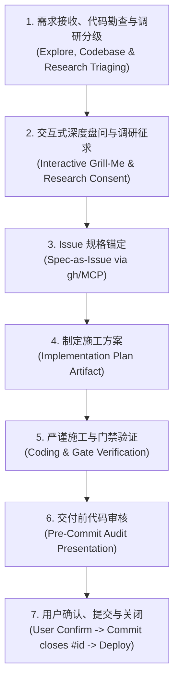

# Agent Skills 知识库与工作流集合 🚀

[](https://github.com/shooter119/skills)
[](https://opensource.org/licenses/MIT)

欢迎来到个人专属的 **AI Agent Skills 知识库与规范仓库**！

本仓库主要收录面向 **Google Antigravity**、**Gemini CLI** 以及现代自主智能体（Coding Agents）的定制化技能（Skills）与标准化协作规范。每个技能均严格遵循智能体技能协议，封装最佳工程实践、领域上下文与自动化工作流。

---

## 📂 技能索引（Skills Catalog）

| 技能名称 | 目录 | 适用场景 / 简介 |
| :--- | :--- | :--- |
| **Day Day Up** | [`day-day-up/`](./day-day-up/) | **标准化闭环研发协作规范**。基于 Issue-Driven 规格锚定理念，覆盖从需求勘查、交互对齐、Issue 锚定、施工方案、门禁验证到代码审核的严谨全流程。 |

*(更多定制化技能持续演进与更新中...)*

---

## 🌟 核心技能速览：Day Day Up

`day-day-up` 是为高可靠、高质量软件工程协作打造的黄金工作流。其核心理念为：
> **“深度勘查与调研、层层对齐、Issue 锚定、方案先行、门禁严明、审核确认、闭环上线”**

彻底告别 AI 盲目写代码、未经追踪粗暴合并、缺少测试直接交付等痛点。

### 核心七步闭环流程（The 7-Step Issue-Driven Loop）



1. **需求勘查与调研分级**：代码库探查优先（Explore First），根据变更复杂度智能分级调研需求，节约 Token。
2. **交互式深度盘问（Grill-Me）**：单次单问、选项置顶推荐，前置决策锁定后再收敛。
3. **Issue 规格锚定（Spec-as-Issue）**：动工前通过 `gh issue create` 创建唯一追踪单，将 Issue 作为唯一状态机边界。
4. **施工方案先行（Implementation Plan）**：通过 Artifact 呈现模块设计、质量门禁与验证策略。
5. **严谨施工与全套门禁**：测试用例只增不减，严格保持 0 报警、0 失败。
6. **交付前审核（Pre-Commit Audit）**：绝对红线——未经用户审核绝不私自 commit。
7. **确认提交与关闭（Closes #id）**：用户确认后自动提交关联关闭 Issue，并按需执行线上部署。

---

## 🛠️ 安装与使用指南

### 1. 全局安装到 Antigravity / Gemini

可以将本仓库直接软链接（Symlink）或克隆到本地全局 Skills 目录：

```bash
# 进入本地全局技能配置目录（以 macOS 为例）
cd ~/.gemini/config/skills/

# 方案 A：克隆完整仓库到工作区，并软链接需要的技能（推荐）
git clone https://github.com/shooter119/skills.git ~/skills-repo
ln -s ~/skills-repo/day-day-up ~/.gemini/config/skills/day-day-up

# 方案 B：直接将整个仓库作为技能目录使用
```

### 2. 项目工作区级集成

在特定项目的根目录下，将所需技能放入 `skills/` 或 `.gemini/skills/` 目录中：

```bash
cd /path/to/your/project
mkdir -p skills
cp -r /path/to/skills/day-day-up skills/
```

智能体在加载上下文时会自动读取对应技能的 `SKILL.md`，并在日常交互与编码任务中主动激活遵守。

---

## 📌 新增技能规范

未来在本仓库中新增技能时，请保持如下标准目录结构：

```
skills/
├── README.md                  # 仓库索引与说明文档
├── .gitignore                 # 忽略无用与敏感文件
├── day-day-up/                # 技能目录（kebab-case 命名）
│   └── SKILL.md               # 必须包含 YAML Frontmatter (name, description)
└── <new-skill-name>/          # 新技能目录
    ├── SKILL.md               # 核心指令与规范
    ├── scripts/               # （可选）自动化脚本或辅助工具
    ├── resources/             # （可选）静态模版或资产
    └── references/            # （可选）领域参考资料
```

### `SKILL.md` 格式参考

```yaml
---
name: your-skill-name
description: >-
  简要描述该技能的功能、核心机制、触发条件及输入输出预期。
---

# 技能标题

## 核心规则与指南
...
```

---

## 📄 License

本项目基于 [MIT 许可证](LICENSE) 开源。欢迎交流与拓展！
