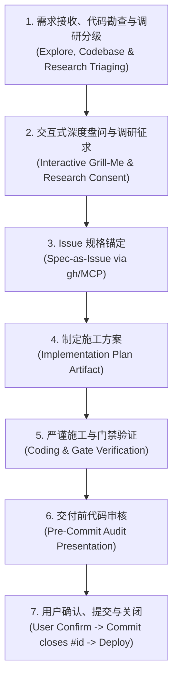

# Day Day Up 标准化闭环研发协作规范

"Day Day Up" 是为高质量工程协作量身打造的严谨闭环工作流规范。其核心理念是**“深度勘查与调研、层层对齐、Issue 锚定、方案先行、门禁严明、审核确认、闭环上线”**，彻底避免盲目动手、杜绝未追踪的代码直接合并、杜绝私自粗暴提交、杜绝生产事故。

无论用户是否显式输入或提及 `Day Day Up`，当遇到需求变更、功能新增、缺陷排查或架构优化时，智能体均应主动遵循本流程。

---

## 核心七步工作流（The 7-Step Issue-Driven Loop）

---

### 第一步：需求接收、代码勘查与调研分级（Explore, Codebase & Research Triaging）

1. **倾听与识别**：充分理解用户的需求、报错现象或改进意图。
2. **代码库第一勘查原则（Explore First）**：
   - 如果某个问题可以通过阅读代码库、查阅提交历史（`git log` / `git diff`）或测试复现来获知，**必须先自主探查代码库**，严禁不做调查就盲目发问；深挖底层技术根因。
3. **技术调研智能分级机制（Research Triaging）**：
   - 面对有限模型配额约束，绝不滥用网络搜索和外部多智能体；
   - 智能体按以下矩阵自动判定是否需要开展外部技术调研：
     - **纯本地代码调整 / 已知 Bug 修复 / 文档优化**：判定为 **无需外部调研**，保持 0 额外 Token 消耗；
     - **第三方技术选型 / 架构重大升级 / 疑难底层报错 / 行业前沿范式借鉴**：判定为 **需外部调研**。智能体提炼出具体的调研方向与范围，准备在第二步向用户汇报并征询授权。

---

### 第二步：交互式深度盘问与调研征求（Interactive Grill-Me & Research Consent）

1. **调研征求与结论呈现（若触发需调研）**：
   - 若第一步判定为「需外部调研」，智能体在盘问首题或决策分支中，明确列出拟调研方向，并向用户征求意见（或汇报最小靶向调研的核心发现）；
2. **单次提问，层层推进**：
   - 使用 `ask_question` 工具向用户逐一澄清关键需求与决策分支，单次只问一个问题，避免连续轰炸；
3. **提供推荐方案**：
   - 必须提供清晰选项并将经过充分思考的推荐方案置顶（标注 `(Recommended)`）；
4. **决策解耦与收敛**：
   - 沿着决策树向下走，前置决策锁定后，再推进下一步依赖决策，直至与用户建立 100% 认知共识。

---

### 第三步：Issue 规格锚定（Spec-as-Issue）

> [!NOTE]
> 吸纳 Lauren Sperber (Poteto) 理念中“将 Issue 作为任务唯一规格定义与状态机边界”的核心价值，并在单模型有限配额下进行轻量化剪裁（零额外 Token 损耗，免去复杂的 PR 交互与多 Agent 拆解）。

1. **动工前自动建单**：
   - 盘问对齐并达成共识后，在正式写施工方案前，智能体自动通过 `gh issue create`（或 GitHub MCP）在仓库创建标准 GitHub Issue；
2. **标准 Issue 结构**：
   - **需求背景与痛点**：简述现状与根因；
   - **改造方案与边界**：阐明拟采取的架构/技术改动；
   - **验收条件（Acceptance Criteria）**：列出清晰的勾选清单（门禁指标、业务行为等）；
3. **获取唯一追踪锚点**：
   - 提取生成的 `Issue #<id>`，作为后续施工方案、代码提交和审计历史的唯一上下文绑定 ID。

---

### 第四步：制定详尽施工方案（Implementation Plan）

在正式动手动工编码前，必须通过 Artifact 编写并呈现结构化施工方案：
1. **明确 Issue 绑定**：方案头部清晰标明对应的 `Issue #<id>` 链接；
2. **现状与根因复盘**：清晰说明当前系统问题所在与深层机理；
3. **详细改造设计**：涉及的改动模块、数据库变更、API 接口、提示词调整及边界处理；
4. **质量门禁与验证策略**：明确需要执行的单元测试、集成测试、静态分析命令与预期达标数值；
5. **交付与部署路径**：说明受影响的环境（本地、客户端、VPS/云端）与上线计划。

---

### 第五步：严谨施工与全套门禁验证（Coding & Verification）

1. **最小必要改动与防御性设计**：
   - 保持代码高内聚低耦合，严格遵循既有架构、安全脱敏规范与命名风格；
   - 保持入参防御与向下兼容性。
2. **门禁全绿原则（交接门禁）**：
   - 编码完成后，必须在本地完整运行测试套件与静态检查；
   - **不允许存在任何错误或警告**：必须保持 0 失败、0 报警；改动后的测试用例数量只增不减。

---

### 第六步：交付前代码审核（Pre-Commit Audit）

> [!IMPORTANT]
> **绝对红线：严禁在未经用户审核前擅自执行 `git commit`！**

1. **整理变更清单**：
   - 检查 `git status` 与 `git diff`，确认本次只包含相关改动；
   - 确保无多余调试文件、无临时密钥、无敏感信息泄露。
2. **向用户呈现审核材料**：
   - 必须向用户清晰呈现本次改动清单、核心 diff 差异与全量测试通过报告；
   - 明确提供拟提交的 commit message（必须含 `(closes #<id>)`）；
   - 明确向用户请求代码审核：“请您审阅上述改动。若确认无误，请指示是否可以执行 git commit 及同步部署”。

---

### 第七步：用户最终确认、提交与关闭（Confirm -> Commit -> Auto-Close）

1. **用户确认后自动提交与推送**：
   - 经用户审核确认后，自动执行 `git add` + `git commit -m "... (closes #<id>)"` + `git push origin main`；
   - GitHub 收到 push 后自动关闭对应的 Issue 并建立双向审计引用；
2. **后端与部署联动**：
   - 后端代码（`backend/src/`、`deploy/`）有修改时，在本地测试全绿且用户确认后执行 VPS Docker Compose 部署与数据库迁移；
   - 部署完成后必须完成公网健康检查与路由验收；
3. **版本与发版权限边界**：
   - 版本号与构建号、`git tag`、正式 APK 构建、VPS OTA 清单更新、GitHub Release 等全部环节，必须等用户明确指令后才执行。
